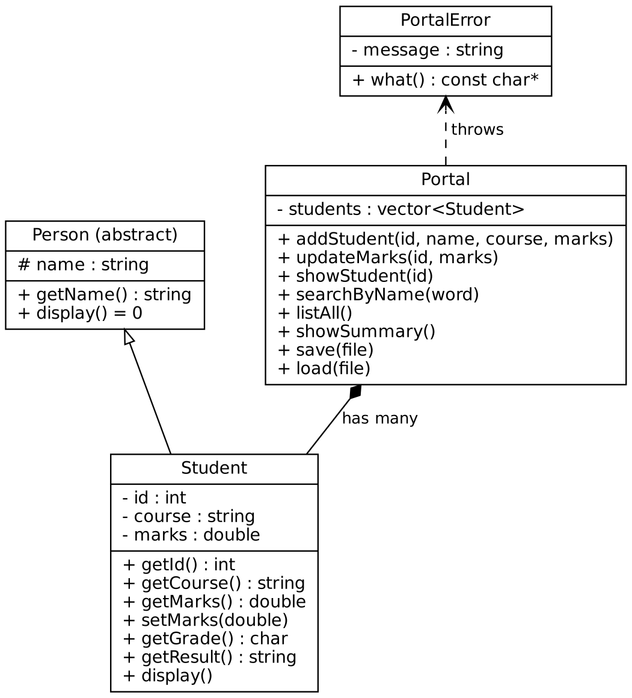

# Mini Project: Student Portal

Console program for a teacher or college office. It keeps a record of students (ID, name, course and marks), finds their grade and result, and saves the data in a CSV file so nothing is lost when the program is closed.

## Features

- Add a student with checks: ID must be positive and not repeated, name and course not empty, marks between 0 and 100
- List all students, search by a word in the name, and show the result of one student
- Update the marks of a student
- Grade and result are calculated from the marks: A (75+), B (60+), C (40+), F (below 40); PASS from 40
- Summary: number of students, average marks and number passed
- Wrong input (letters instead of numbers, unknown ID, bad marks) shows a clear message and the program keeps running
- Data is loaded from `data/students.csv` at the start and saved when you exit; bad lines in the file are skipped

## Classes

| Class | Work |
|-------|------|
| `Person` (abstract) | Base class with the name; `display()` is a pure virtual function |
| `Student` | Derived from Person; adds id, course and marks; calculates grade and result |
| `Portal` | Keeps the students in a `vector`; add, update, search, list, summary, save, load |
| `PortalError` | Our own exception class (derived from `std::exception`) |

## UML class diagram



## Use of the course concepts

- **Classes and inheritance:** Student is derived from the abstract class Person; data members are private or protected and used through member functions.
- **STL:** `vector<Student>` stores the records.
- **File handling:** `ifstream` and `ofstream` read and write the CSV file; a missing file is handled.
- **Exception handling:** `PortalError` is thrown for wrong IDs, bad marks, duplicates and empty fields, and caught in `main()`.

## Compile and run

```bash
g++ -o portal src/main.cpp
./portal --demo               # scripted demo with normal and error cases
./portal < input_valid.txt    # menu with an input file
```

## Sample data (`data/students.csv`)

```text
id,name,course,marks
101,Daksh Soni,B.Tech AIDS,78
102,Aman Verma,B.Tech AIDS,66
103,Neha Patel,B.Tech CSE,91
104,Karan Singh,B.Tech CSE,35
105,Priya Nair,B.Tech AIDS,58
```

## Output of demo mode (`./portal --demo`)

```text
=== All students ===
101 | Daksh Soni | B.Tech AIDS | 78 | Grade A | PASS
102 | Aman Verma | B.Tech AIDS | 66 | Grade B | PASS
103 | Neha Patel | B.Tech CSE | 91 | Grade A | PASS
104 | Karan Singh | B.Tech CSE | 35 | Grade F | FAIL
105 | Priya Nair | B.Tech AIDS | 58 | Grade C | PASS

Add student 106 -> OK
Add student 101 again -> Error: Student ID 101 already exists
Add student with marks 150 -> Error: Marks must be between 0 and 100
Add student with ID 0 -> Error: ID must be a positive number
Add student with empty name -> Error: Name and course cannot be empty
Update marks of 104 to 55 -> OK
Update marks of 999 -> Error: Student ID 999 not found

Search for 'Soni':
101 | Daksh Soni | B.Tech AIDS | 78 | Grade A | PASS

=== All students now ===
101 | Daksh Soni | B.Tech AIDS | 78 | Grade A | PASS
102 | Aman Verma | B.Tech AIDS | 66 | Grade B | PASS
103 | Neha Patel | B.Tech CSE | 91 | Grade A | PASS
104 | Karan Singh | B.Tech CSE | 55 | Grade C | PASS
105 | Priya Nair | B.Tech AIDS | 58 | Grade C | PASS
106 | Meera Joshi | B.Tech AIDS | 82 | Grade A | PASS

Students: 6, Average marks: 71.6667, Passed: 6
Saved to data/students.csv
```

## Output of the menu with valid input

```text

1. Add student
2. List students
3. Search by name
4. Show result of one student
5. Update marks
6. Summary
0. Save and exit
Enter choice: 2
101 | Daksh Soni | B.Tech AIDS | 78 | Grade A | PASS
102 | Aman Verma | B.Tech AIDS | 66 | Grade B | PASS
103 | Neha Patel | B.Tech CSE | 91 | Grade A | PASS
104 | Karan Singh | B.Tech CSE | 35 | Grade F | FAIL
105 | Priya Nair | B.Tech AIDS | 58 | Grade C | PASS

1. Add student
2. List students
3. Search by name
4. Show result of one student
5. Update marks
6. Summary
0. Save and exit
Enter choice: 3
Search word: Soni
101 | Daksh Soni | B.Tech AIDS | 78 | Grade A | PASS

1. Add student
2. List students
3. Search by name
4. Show result of one student
5. Update marks
6. Summary
0. Save and exit
Enter choice: 4
Student ID: 104
104 | Karan Singh | B.Tech CSE | 35 | Grade F | FAIL

1. Add student
2. List students
3. Search by name
4. Show result of one student
5. Update marks
6. Summary
0. Save and exit
Enter choice: 5
Student ID: 104
New marks: 55
Marks updated

1. Add student
2. List students
3. Search by name
4. Show result of one student
5. Update marks
6. Summary
0. Save and exit
Enter choice: 6
Students: 5, Average marks: 69.6, Passed: 5

1. Add student
2. List students
3. Search by name
4. Show result of one student
5. Update marks
6. Summary
0. Save and exit
Enter choice: 1
ID: 106
Name: Meera Joshi
Course: B.Tech AIDS
Marks: 82
Student added

1. Add student
2. List students
3. Search by name
4. Show result of one student
5. Update marks
6. Summary
0. Save and exit
Enter choice: 2
101 | Daksh Soni | B.Tech AIDS | 78 | Grade A | PASS
102 | Aman Verma | B.Tech AIDS | 66 | Grade B | PASS
103 | Neha Patel | B.Tech CSE | 91 | Grade A | PASS
104 | Karan Singh | B.Tech CSE | 55 | Grade C | PASS
105 | Priya Nair | B.Tech AIDS | 58 | Grade C | PASS
106 | Meera Joshi | B.Tech AIDS | 82 | Grade A | PASS

1. Add student
2. List students
3. Search by name
4. Show result of one student
5. Update marks
6. Summary
0. Save and exit
Enter choice: 0
Saved. Bye!
```

## Output of the menu with invalid input

```text

1. Add student
2. List students
3. Search by name
4. Show result of one student
5. Update marks
6. Summary
0. Save and exit
Enter choice: abc
Please enter a number

1. Add student
2. List students
3. Search by name
4. Show result of one student
5. Update marks
6. Summary
0. Save and exit
Enter choice: 9
Invalid choice

1. Add student
2. List students
3. Search by name
4. Show result of one student
5. Update marks
6. Summary
0. Save and exit
Enter choice: 4
Student ID: 999
Error: Student ID 999 not found

1. Add student
2. List students
3. Search by name
4. Show result of one student
5. Update marks
6. Summary
0. Save and exit
Enter choice: 1
ID: 0
Name: Zero Id
Course: B.Tech AIDS
Marks: 50
Error: ID must be a positive number

1. Add student
2. List students
3. Search by name
4. Show result of one student
5. Update marks
6. Summary
0. Save and exit
Enter choice: 1
ID: 107
Name: Rohan Das
Course: B.Tech AIDS
Marks: abc
Error: Marks must be a number

1. Add student
2. List students
3. Search by name
4. Show result of one student
5. Update marks
6. Summary
0. Save and exit
Enter choice: 1
ID: 108
Name: Rohan Das
Course: B.Tech AIDS
Marks: 150
Error: Marks must be between 0 and 100

1. Add student
2. List students
3. Search by name
4. Show result of one student
5. Update marks
6. Summary
0. Save and exit
Enter choice: 1
ID: 101
Name: Duplicate
Course: B.Tech AIDS
Marks: 50
Error: Student ID 101 already exists

1. Add student
2. List students
3. Search by name
4. Show result of one student
5. Update marks
6. Summary
0. Save and exit
Enter choice: 5
Student ID: 999
New marks: 50
Error: Student ID 999 not found

1. Add student
2. List students
3. Search by name
4. Show result of one student
5. Update marks
6. Summary
0. Save and exit
Enter choice: 0
Saved. Bye!
```

## Memory check (Valgrind)

```text
Memcheck, a memory error detector
Copyright (C) 2002-2022, and GNU GPL'd, by Julian Seward et al.
Using Valgrind-3.22.0 and LibVEX; rerun with -h for copyright info
Command: ./portal --demo


HEAP SUMMARY:
    in use at exit: 0 bytes in 0 blocks
  total heap usage: 38 allocs, 38 frees, 97,957 bytes allocated

All heap blocks were freed -- no leaks are possible

For lists of detected and suppressed errors, rerun with: -s
ERROR SUMMARY: 0 errors from 0 contexts (suppressed: 0 from 0)
```

## Source code (`src/main.cpp`)

```cpp
// Mini Project: Student Portal (simple console application)
// Run:  ./portal          -> menu
//       ./portal --demo   -> demo with normal and error cases
#include <iostream>
#include <fstream>
#include <sstream>
#include <vector>
#include <string>
#include <exception>
using namespace std;

// ---------- Exception class ----------
class PortalError : public exception {
    string message;
public:
    PortalError(string m) { message = m; }
    const char* what() const noexcept { return message.c_str(); }
};

// ---------- Base class ----------
class Person {
protected:
    string name;
public:
    Person(string n) { name = n; }
    string getName() { return name; }
    virtual void display() = 0;        // pure virtual -> Person is abstract
    virtual ~Person() {}
};

// ---------- Derived class ----------
class Student : public Person {
    int id;
    string course;
    double marks;
public:
    Student(int i, string n, string c, double m) : Person(n) {
        id = i;
        course = c;
        marks = m;
    }
    int getId() { return id; }
    string getCourse() { return course; }
    double getMarks() { return marks; }
    void setMarks(double m) { marks = m; }

    // Simple result: grade and pass/fail from the marks
    char getGrade() {
        if (marks >= 75) return 'A';
        if (marks >= 60) return 'B';
        if (marks >= 40) return 'C';
        return 'F';
    }
    string getResult() { return marks >= 40 ? "PASS" : "FAIL"; }

    void display() {
        cout << id << " | " << name << " | " << course << " | "
             << marks << " | Grade " << getGrade() << " | " << getResult() << "\n";
    }
};

// ---------- Portal class ----------
class Portal {
    vector<Student> students;          // STL container

    int findIndex(int id) {
        for (int i = 0; i < (int)students.size(); i++)
            if (students[i].getId() == id) return i;
        throw PortalError("Student ID " + to_string(id) + " not found");
    }
public:
    // Validate ID and marks before adding
    void addStudent(int id, string name, string course, double marks) {
        if (id <= 0)
            throw PortalError("ID must be a positive number");
        if (name == "" || course == "")
            throw PortalError("Name and course cannot be empty");
        if (marks < 0 || marks > 100)
            throw PortalError("Marks must be between 0 and 100");
        for (int i = 0; i < (int)students.size(); i++)
            if (students[i].getId() == id)
                throw PortalError("Student ID " + to_string(id) + " already exists");
        students.push_back(Student(id, name, course, marks));
    }

    void updateMarks(int id, double marks) {
        if (marks < 0 || marks > 100)
            throw PortalError("Marks must be between 0 and 100");
        students[findIndex(id)].setMarks(marks);
    }

    void showStudent(int id) {
        students[findIndex(id)].display();
    }

    void searchByName(string word) {
        bool found = false;
        for (int i = 0; i < (int)students.size(); i++) {
            if (students[i].getName().find(word) != string::npos) {
                students[i].display();
                found = true;
            }
        }
        if (!found) cout << "No student found\n";
    }

    void listAll() {
        for (int i = 0; i < (int)students.size(); i++)
            students[i].display();
    }

    void showSummary() {
        if (students.size() == 0) { cout << "No students\n"; return; }
        double total = 0; int passed = 0;
        for (int i = 0; i < (int)students.size(); i++) {
            total += students[i].getMarks();
            if (students[i].getMarks() >= 40) passed++;
        }
        cout << "Students: " << students.size() << ", Average marks: "
             << total / students.size() << ", Passed: " << passed << "\n";
    }

    // Save all students to a CSV file
    void save(string file) {
        ofstream out(file);
        if (!out) throw PortalError("Cannot open file " + file);
        out << "id,name,course,marks\n";
        for (int i = 0; i < (int)students.size(); i++)
            out << students[i].getId() << "," << students[i].getName() << ","
                << students[i].getCourse() << "," << students[i].getMarks() << "\n";
    }

    // Load students from a CSV file (bad lines are skipped)
    void load(string file) {
        ifstream in(file);
        if (!in) throw PortalError("Cannot open file " + file);
        string line;
        getline(in, line);                       // skip header line
        while (getline(in, line)) {
            stringstream ss(line);
            string id, name, course, marks;
            getline(ss, id, ',');
            getline(ss, name, ',');
            getline(ss, course, ',');
            getline(ss, marks, ',');
            if (id == "" || name == "" || course == "" || marks == "") continue;
            try {
                addStudent(stoi(id), name, course, stod(marks));
            } catch (exception& e) {
                cout << "Skipped bad line: " << line << "\n";
            }
        }
    }
};

// ---------- Helper for the demo ----------
void tryAdd(Portal& p, int id, string name, string course, double marks, string text) {
    cout << text << " -> ";
    try { p.addStudent(id, name, course, marks); cout << "OK\n"; }
    catch (exception& e) { cout << "Error: " << e.what() << "\n"; }
}

int main(int argc, char* argv[]) {
    Portal portal;
    string file = "data/students.csv";

    try {
        portal.load(file);
    } catch (exception& e) {
        cout << e.what() << " (starting with empty portal)\n";
    }

    if (argc > 1 && string(argv[1]) == "--demo") {
        cout << "=== All students ===\n";
        portal.listAll();
        cout << "\n";
        tryAdd(portal, 106, "Meera Joshi", "B.Tech AIDS", 82, "Add student 106");
        tryAdd(portal, 101, "Duplicate", "B.Tech AIDS", 50, "Add student 101 again");
        tryAdd(portal, 107, "Rohan Das", "B.Tech AIDS", 150, "Add student with marks 150");
        tryAdd(portal, 0, "Zero Id", "B.Tech AIDS", 50, "Add student with ID 0");
        tryAdd(portal, 108, "", "B.Tech AIDS", 50, "Add student with empty name");
        cout << "Update marks of 104 to 55 -> ";
        try { portal.updateMarks(104, 55); cout << "OK\n"; }
        catch (exception& e) { cout << "Error: " << e.what() << "\n"; }
        cout << "Update marks of 999 -> ";
        try { portal.updateMarks(999, 55); cout << "OK\n"; }
        catch (exception& e) { cout << "Error: " << e.what() << "\n"; }
        cout << "\nSearch for 'Soni':\n";
        portal.searchByName("Soni");
        cout << "\n=== All students now ===\n";
        portal.listAll();
        cout << "\n";
        portal.showSummary();
        portal.save(file);
        cout << "Saved to " << file << "\n";
        return 0;
    }

    int choice = -1;
    while (choice != 0) {
        cout << "\n1. Add student\n2. List students\n3. Search by name\n4. Show result of one student\n"
                "5. Update marks\n6. Summary\n0. Save and exit\n";
        cout << "Enter choice: ";
        if (!(cin >> choice)) {                 // wrong input like letters
            cin.clear();
            cin.ignore(1000, '\n');
            cout << "Please enter a number\n";
            choice = -1;
            continue;
        }
        cin.ignore(1000, '\n');
        try {
            if (choice == 1) {
                int id; string name, course; double marks;
                cout << "ID: "; cin >> id; cin.ignore(1000, '\n');
                cout << "Name: "; getline(cin, name);
                cout << "Course: "; getline(cin, course);
                cout << "Marks: "; cin >> marks;
                if (!cin) { cin.clear(); cin.ignore(1000, '\n'); throw PortalError("Marks must be a number"); }
                portal.addStudent(id, name, course, marks);
                cout << "Student added\n";
            } else if (choice == 2) {
                portal.listAll();
            } else if (choice == 3) {
                string word;
                cout << "Search word: "; getline(cin, word);
                portal.searchByName(word);
            } else if (choice == 4) {
                int id; cout << "Student ID: "; cin >> id;
                portal.showStudent(id);
            } else if (choice == 5) {
                int id; double marks;
                cout << "Student ID: "; cin >> id;
                cout << "New marks: "; cin >> marks;
                portal.updateMarks(id, marks);
                cout << "Marks updated\n";
            } else if (choice == 6) {
                portal.showSummary();
            } else if (choice == 0) {
                portal.save(file);
                cout << "Saved. Bye!\n";
            } else {
                cout << "Invalid choice\n";
            }
        } catch (exception& e) {
            cout << "Error: " << e.what() << "\n";
        }
    }
    return 0;
}
```
